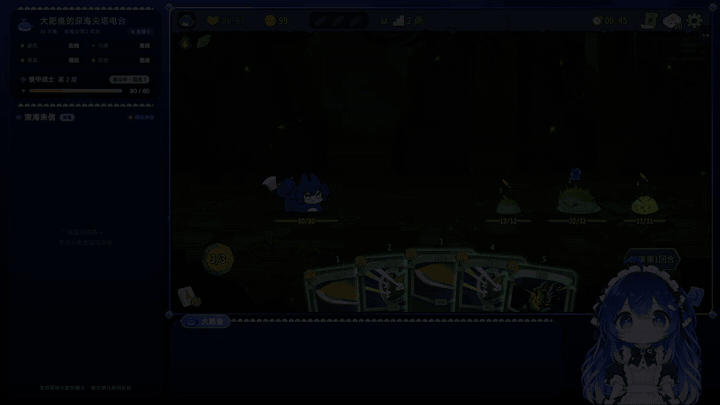
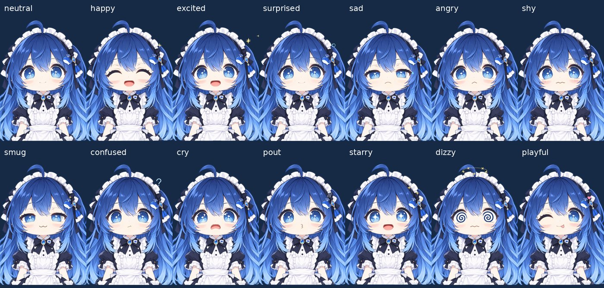

# 大肥鱼 · AI 杀戮尖塔2 直播主播

一个在 B站直播《杀戮尖塔2》的中文 AI 虚拟主播。她自己打牌、自己解说、自己回弹幕：对观众来说就是一个人。

- **打牌**：游戏里装 [STS2-Agent](https://github.com/CharTyr/STS2-Agent) Mod（我们的补丁版见下文），用一把 DeepSeek key 决策出牌。
- **说话**：本仓库的主播程序用另一把 DeepSeek key 想台词，ElevenLabs 合成语音，OBS 浏览器源显示形象、字幕、弹幕和状态卡。

两边各用各的 key、各跑各的进程，靠本机 HTTP 接口配合。

## 演示

[](https://wangding0610.github.io/dafeiyu-vtuber/)

实机录屏剪成 22 秒，依次是：回合开头说打算，整回合连着出牌；叫昵称回弹幕；斩杀前先喊再出手；打完战斗领奖励。GIF 没有声音，**[点这里看带声音的版本](https://wangding0610.github.io/dafeiyu-vtuber/)**（或直接下载 [demo.mp4](docs/media/demo.mp4)）。

## 表情

<p>


</p>
<br clear="left">

自研 WebGL 网格形象，14 种表情：日常、开心、兴奋、惊讶、难过、生气、害羞、得意、疑惑、哭哭、鼓脸、星星眼、晕乎乎、吐舌眨眼。口型跟着实际音频走，会自己眨眼，头发和饰品有物理摆动；台词的情绪决定表情。

## 特点

- **先说后打**：Mod 每次出手前先问主播程序。值得说的一步，她先说完 Mod 才出牌，声音和画面对得上；不值得说的立刻放行。主播程序没开时不影响游戏。
- **整回合规划**（Mod 补丁）：战斗中 AI 一次想好整回合的出牌顺序，后面几张不再调用模型；抽到新牌、弹出选择、目标死亡时把原计划交回去修改，而不是从零想。
- **观众引导打法**：她回弹幕时顺便判断这是不是打法主意，是就挂到“观众建议板”上。打牌的 AI 在最近的衔接点看到建议，自己权衡要不要听（类似 Codex 的“引导”，不是排队执行的指令）；它采纳或拒绝谁的建议，她出手前会点名说一句。
- **像人一样聊天**：回弹幕时叫出对方昵称；有心情、有直播间气氛；认得回头客；下播后写日记、整理熟人印象和直播间的梗，可选自动发一条 B站动态。
- **台词节奏**：牌局台词一句、20 字以内；每回合开头说打算，保命和斩杀再说一句；画面已经过去的台词直接丢掉不念。
- **安全边界**：只监听本机；弹幕、昵称、记忆都当作数据不当指令；密钥只放在 `.env`；不发弹幕。

## 架构

```text
观众弹幕 ──► 主播程序（本仓库，Python）──► DeepSeek（台词，key B）──► ElevenLabs ──► OBS 形象/字幕
                │  ▲
   观众建议板 ──┘  │ 状态、事件、决策记录；出手前 POST /api/narrate 等她说完
                ▼  │
           STS2-Agent Mod（C#，游戏内）──► DeepSeek（出牌，key A）──► 杀戮尖塔2
```

更完整的说明见 [docs/双API架构核查-2026-10-26.md](docs/双API架构核查-2026-10-26.md)。

## 需要准备

- Windows 10/11，Python 3.12，OBS Studio 30+。
- Steam 版《杀戮尖塔2》，并装好 STS2-Agent Mod（建议用下面的补丁版）。
- 两把 DeepSeek API key（打牌一把、说话一把；用同一把也能跑，但费用和限额会算在一起）。
- ElevenLabs API key 和一个中文音色的 voice ID。
- 一个 B站小号，用来读弹幕（扫码登录，Cookie 只存在本机 `.env`）。

## 快速开始

1. 复制 `.env.example` 为 `.env`，填好 DeepSeek、ElevenLabs 的 key 和 `BILI_ROOM_ID`（直播间房间号）。
2. 双击 `login_bilibili.bat`，用 B站小号扫码登录。
3. 关掉 OBS，运行 `python scripts/make_obs.py`，生成 OBS 配置文件、场景和 `obs.bat`。
4. 开游戏，在 Mod 面板打开自动游玩。要启用先说后打和观众引导，在 `%APPDATA%\STS2AIAgent\narrator.txt` 里写一行 `http://127.0.0.1:8765/api/narrate`。
5. 双击 `start.bat` 启动主播程序（第一次会自动建 `.venv` 装依赖），再双击 `obs.bat` 开 OBS，然后在 B站开播、OBS 推流。

不花钱试运行：`start.bat --offline`。真实游戏 + 在控制页手动发测试弹幕：`start.bat --manual-chat --live-game`，控制页在 `http://127.0.0.1:8765/overlay/control/`。

配置项、OBS 来源、费用控制、测试方法等都在 [docs/详细说明.md](docs/详细说明.md)。

## Mod 补丁

整回合规划、先说后打、观众引导和药水栏满时不卡住，都是对 STS2-Agent 的补丁，按上游的 AGPL-3.0 公开在：

**https://github.com/wangding0610/STS2-Agent/tree/dafeiyu-live**

需要自己编译 DLL 并替换创意工坊里的 `STS2AIAgent.dll`（替换前关掉游戏；创意工坊更新会覆盖补丁）。不装补丁也能用，只是没有先说后打、整回合规划和观众引导。

## 测试

```bat
.venv\Scripts\python.exe -m unittest discover -s tests
```

## 许可

- 本仓库的代码和文档：[MIT](LICENSE)。
- 形象素材 `overlay/avatar/packs/whale-maid/`、`overlay/avatar/packs/dsh-whale/`：**CC BY-NC-SA 4.0，仅限非商业使用**，署名见各目录的 `ATTRIBUTION.md`。
  - 原型「溟月」：B站 @上善无形；女仆鲸鱼娘（大肥鱼）设计：B站 @ZipZipPipe；dsh-whale 动画来自 [dsh-pet](https://github.com/PC2005-cloud/dsh-pet)。
  - 这是社区二创形象，**不是 DeepSeek 官方形象**。原作者声明“不可以以任何形式商业化”，直播时请在直播间简介写明署名；想商用请换成自己的形象（改 `overlay/avatar/avatar.json` 的 `pack`）。
- `vendor/blivedm/`：MIT，Copyright (c) 2018 xfgryujk。
- STS2-Agent 补丁：AGPL-3.0，跟随上游。

本项目与 Mega Crit、DeepSeek、ElevenLabs、哔哩哔哩没有关联。
