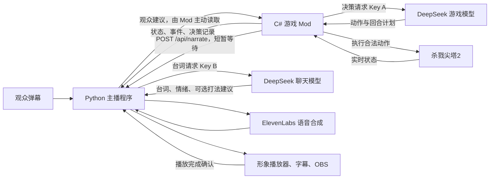

# 大肥鱼直播：游戏 API 与聊天 API 架构核查

核查日期：2026-10-26。依据当前本地源码、保存的配置与已安装 DLL；不以交接文档中的历史描述代替代码。

后续变更：本报告完成后，同日已将熟人档案改为正式直播中记录来访、随聊天回复更新印象，并在逐条回复前按 UID 读取档案。以下记忆部分保留核查时的架构描述；当前行为见 [详细说明里的记忆部分](详细说明.md)。

## 1. 核心结论

系统由两个独立应用组成。游戏内的 C# Mod 调用 DeepSeek 作出决策并执行游戏动作。独立的 Python 主播程序调用 DeepSeek 生成台词，再调用 ElevenLabs 合成声音。

两端使用不同的 API 密钥，当前实际请求的模型名称均为 `deepseek-chat`。它们不共享同一段模型对话，也不共享角色记忆。观众看到的统一身份主要由主播提示词和数据交换实现。

目前两端有三条业务通路：游戏状态与决策记录、动作执行前的解说等待、观众打法建议。第三条已经存在于当前源码，不能再把主播端描述成“只能观察，完全不能影响决策”。主播端仍没有直接执行游戏动作的入口。



图中的游戏和聊天模型是两条独立调用链，当前指向同一供应商、同一模型标识。不同密钥不代表不同供应商账号或账户额度；本次没有核验供应商账户关系。

## 2. 当前配置核对

| 项目 | 游戏端 A | 主播端 B |
|---|---|---|
| 本地程序 | `sts2-agent-patch/STS2AIAgent`，C#，随游戏加载 | `vtuber-host/host`，Python/aiohttp，独立进程 |
| 配置入口 | `%APPDATA%/STS2AIAgent/settings.json` | `config.yaml` 与 `.env` |
| 实际请求模型 | `deepseek-chat` | `deepseek-chat` |
| 服务主机 | `api.deepseek.com` | `api.deepseek.com` |
| 密钥 | Mod 设置内的 Key A | `.env` 中的 `DEEPSEEK_HOST_API_KEY`，与 A 不同 |
| 调用方式 | 通常流式返回，支持工具调用；含兼容性回退 | 非流式 JSON 返回，无工具调用 |
| 思考配置 | 模型级 `thinkingIntensity=low`、`thinkingMode=auto`，代码据此发送 `thinking.type=enabled` | 请求未显式传入 `thinking`，不能仅凭源码确认服务端内部推理模式 |
| 游戏权限 | 读状态、查资料、执行合法动作 | 读取游戏接口；发布供游戏端参考的建议 |
| 本地接口 | 默认 `127.0.0.1:8080` | 当前配置 `127.0.0.1:8765` |

游戏端 `playModelId` 为空，会回落到 `conversationModelId=deepseek-flash`。这里的 `deepseek-flash` 是本地配置条目的 ID；该条目真正发送给供应商的 `model` 是 `deepseek-chat`。

Mod 自己也有“对话模型”配置，但这不是独立 Python 主播的聊天模型。当前 Jev 双层决策、视觉模型、Mod 主动聊天和 MCP 开关均未启用；它们不属于本次实际启用的主链路。

语音模型为 `eleven_v4_turbo`。这是第三条外部 API 调用，只负责把主播文本变成音频及时间戳。

## 3. 游戏端 A 如何工作

主要入口为 `AgentLoop.PlayOnceAsync`，模型决策在 `PlayWithModelAsync`，执行检查在 `ExecuteActAsync`。

1. 等游戏进入可操作状态，读取最新的精简游戏状态和可用动作。
2. 读取主播端的观众建议板，同时检查是否有玩家手动输入的游戏指示。
3. 如果已有回合计划且仍然有效，执行计划下一步，不再调用模型。
4. 需要模型时，组装游戏规则、当前画面的攻略、最新状态、适用的历史摘要、观众建议和未完成计划。
5. DeepSeek 可以调用查状态、查游戏资料等工具，再返回一个 `act`。单次决策最多进行 8 轮工具交互。
6. 对动作名称、卡牌索引、目标索引等进行校验，然后调用主播的 `/api/narrate`。
7. 解说等待结束后，通过 `GameBridge` 在游戏主线程执行动作，并记录结果。

游戏端是通过进程内 `GameBridge → GameActionService` 操作游戏，不需要绕到本机 HTTP 接口才能出牌。HTTP `8080` 是向其他程序提供状态和动作服务的另一层接口；主播只使用其中的只读部分。

### 整回合计划

模型在第一次 `act` 中给出当前动作及 `then` 列表。后续列表最多保留 12 步，支持后续出牌与结束回合。第一步可以是出牌或用药水，后续列表不是任意游戏动作的通用脚本。

后续出牌按 `card_id + upgraded` 重新匹配当前手牌，目标还会检查身份和可命中性。出现新牌、选择界面、牌不可用、目标失效、回合/对局变化或结束回合将致死时，计划会停止复用。同回合内可把尚未执行的步骤和打断原因交回模型修订。

这说明“全自动”不是每打一张牌就请求一次模型，也不是把整局操作一次交给模型后盲目执行。

## 4. 主播端 B 如何工作

弹幕通过 vendored `blivedm` 接收，经 `ChatIngress` 过滤和清洗后显示，并交给 `ChatBatcher` 与 `Scheduler`。当前普通弹幕与醒目留言走逐条回复路径，不再经随机挑选与合并。

实际生成与播放由一个串行 `worker` 负责：

```text
选取话题 → 读取当前局面卡和主播记忆 → DeepSeek B
        → 过滤台词、抽取建议 → ElevenLabs → 广播字幕/表情/音频
        → 等待形象播放器确认结束 → 处理下一条话题
```

聊天模型的输入包括角色卡、本次话题、经过压缩的游戏局面、直播状态/心情、部分长期记忆，以及最近 4 条模型生成的主播台词。这 4 条不是最近 4 轮完整的“观众问—主播答”对话。

游戏台词通常限制为一句、20 字；弹幕回复通常一到两句、110 字，补昵称时长度可能略增。模型输出 `text`、`emotion`，回复观众时还可输出 `to` 和 `advice`。

模型本身没有工具，也不持有执行游戏动作的句柄。建议由本地程序读取 `advice` 字段后发布。没有就绪的形象播放器时，正常话题 worker 不调用收费模型/TTS。

形象页通过 WebSocket `/ws` 接收音频、情绪和口型时间轴。只有被选中的一个形象播放器有播放权，并发送 `speech_done` 确认。超时会取消播放并按连续失败次数进入恢复流程。OBS 和直播姬处于画面、声音输出层，不参与模型决策。

## 5. 两端之间交换什么

| 方向与接口 | 用途 | 主要内容与限制 |
|---|---|---|
| B → Mod：`GET /health` | 检查游戏服务 | 服务标识、进程等状态 |
| B → Mod：`GET /state` | 读取游戏快照 | 血量、能量、手牌、敌人、回合、画面等 |
| B → Mod：`GET /events/stream` | 持续接收游戏事件 | 决策、战斗开始/结束、画面切换等；SSE 即服务器持续推送事件 |
| B → Mod：`GET /decisions?limit=10` | 补读决策记录 | 动作、理由等；首次连接跳过历史播报 |
| B → Mod：`GET /data/monsters` | 补充怪物类别 | 每个游戏进程缓存一次，辅助识别精英/Boss |
| Mod → B：`POST /api/narrate` | 动作前协调解说 | 动作、卡牌/目标/选项索引、简短理由 |
| Mod → B：`GET /api/guidance` | 读取观众建议 | `version` 和若干 `name/text/age` |

主播读取游戏接口有固定路径白名单，没有调用游戏的 `/action`。游戏状态快照正常间隔为 8 秒，部分 SSE 事件会触发提前刷新，并合并 0.6 秒内的刷新需求；不是每张牌后都重新读取完整快照。决策记录的补读间隔至少 20 秒。

`/api/narrate` 传的是当前 `act.reason`，不是把 A 的整段模型对话转发给 B。事后的决策日志可能包含 A 返回的较详细理由，但 B 仍只截取一部分构造话题。两端没有共享完整提示词、工具对话或共同会话 ID。

### 动作前的解说等待

1. A 已经选定并校验动作后，发送 `/api/narrate`。
2. B 判断是否值得说。没有播放器、不属于解说动作或不值得说时，立即返回。
3. 值得说的动作以优先级 1 入队，但不能打断正在播的句子，也不能突破总请求限额。
4. 5 秒内没有开始处理，取消这条待说话题并放行游戏。
5. 已开始处理则继续等待，主播侧整次通常最多等 10 秒；Mod 自身请求超时为 20 秒。
6. 正常路径中，生成、合成、播放完成后放行。失败或超时也会放行。

Mod 只看 HTTP 请求是否成功，不读取 `said` 来决定是否执行，也不会因为主播“不想说”而否决动作。连接失败等情况会进入 30 秒暂时跳过期；建议读取也共用这段故障跳过状态。开关由 `%APPDATA%/STS2AIAgent/narrator.txt` 提供，目前指向 `http://127.0.0.1:8765/api/narrate`。

战斗中通常讲回合开头的打算、保命和斩杀。普通战斗话语间隔 20 秒，斩杀和回应观众建议有特殊处理；战斗外普通决策解说冷却 60 秒。仍受实际排队和预算约束。

### 观众建议如何进入 A

1. 观众发“先打左边那只”一类弹幕。
2. B 在生成回复的同一次模型请求中判断是否为打法建议，并生成简短 `advice`。
3. 本地安全检查通过后尝试加入 `Guidance`。这发生在 TTS 合成和播放之前。
4. 建议板全场每 20 秒最多收一条，同一个昵称每 60 秒最多收一条，最多保留 3 条，每条保留 90 秒。
5. A 在新决策开始、计划下一步之前、一次决策的两轮工具交互之间读取建议。
6. 如果新建议打断已有计划，A 获得未执行步骤与新建议，重新权衡。正在进行的单个模型请求不会被中途修改。
7. 提示词要求 A 自己判断是否采纳，并在动作理由中提到观众昵称。B 检测理由中的昵称，再尝试安排一句反馈。

建议板是内存中的近期建议集合，不是待执行动作队列。A 可以拒绝建议；B 的聊天回复也不能证明 A 已经采纳。

## 6. 频率、预算与记忆

| 设置 | 当前值与实际含义 |
|---|---|
| 弹幕逐条回复 | `chat_reply_all=true`，适用于普通弹幕和醒目留言 |
| 每人回复限额 | 按 UID：滚动 60 秒最多入队 3 条，开始请求时再次限制最多 3 次 |
| 主播话题总预算 | 每分钟 6 次、每小时 300 次，聊天、游戏解说等共用 |
| 最小请求间隔 | 6 秒；完整生成、合成、播放的串行耗时也会限制速度 |
| 旧弹幕总限额 | 配置仍有 `chat_replies_per_minute=4`，但逐条回复开关开启时不再生效 |
| 旧批处理间隔 | 4 秒；当前普通弹幕/醒目留言直接入队，不等待这个批处理窗口 |
| 话题队列 | 80 条；逐条回复不因等待 50 秒而过期，重启也不会恢复队列 |
| 游戏端预算 | 保存设置为每会话最多 300 次请求、3,000,000 tokens；与主播的“每小时 300 次”是两套计数 |
| 下播整理 | 满 30 分钟后调用 B 写日记/整理记忆，当前动态模式为 `auto` |

回复限额是在开始模型请求时计数，失败也会占用次数，不能把“3 次”理解成保证 3 次成功播放。下播的 `Brain.compose` 直接调用模型，不经过普通话题 Scheduler，因此不应把话题预算理解成所有 B 调用的唯一总账。

A 的记忆以本局状态、决策记录、未完成计划和适用的历史摘要为主。B 的记忆以角色卡、关于我、熟人、梗、日记及少量近期台词为主。B 写日记不会自动训练或修改 A 的打法；当前看不到把 B 长期记忆导入游戏策略的链路。

## 7. 当前架构的主要限制

以下根据代码路径分析，不代表这些问题已经在实际直播中全部发生。

### 7.1 “先说后打”只在时间预算内成立

B 的模型调用超时允许 60 秒，TTS 允许 40 秒，而游戏正常只等待约 10 秒。`narrate()` 超时后仍返回，已开始的 worker 不会因此自动取消。带 gate 的游戏话题还绕过普通的画面变化丢弃检查。

因此慢请求可能造成动作已经执行，台词之后才播放。`said=true` 也不等于观众确实听完：worker 出错会释放 gate，等待超时也会走到返回 true。当前接口更接近“解说等待已结束”，而不是严格的成功播放证明。

### 7.2 B 看到的局面不保证与 A 当前动作相同

`/api/narrate` 没有携带 `run_id`、回合号、状态版本、稳定卡牌身份或同一帧状态。B 用自己的缓存快照把 `card_index`、`target_index` 翻译为牌名和敌人名。

连续出牌、抽牌或界面转换时，B 的缓存可能落后。即使 A 的动作合法，B 仍可能用旧手牌位置描述动作；回合开头判定也依赖 B 的缓存回合号。

### 7.3 建议处理依赖聊天队列

建议只在 B 真正生成该条回复时提取。弹幕尚未轮到、被每人限额挡下、队列已满、没有播放器或模型失败，都可能使建议无法送达 A。

90 秒有效期从建议加入建议板开始，而不是从弹幕到达时开始。逐条弹幕长期排队时，旧建议可能被当成新建议发布。当前数据也没有绑定特定对局、回合或房间，跨战斗/跨局时主要靠 A 自己识别过时内容。

### 7.4 缺少明确的采纳结果

没有“建议 ID → 已收到 → 已采纳/拒绝 → 动作结果”的结构化确认。B 通过 A 的理由是否包含昵称推测需要反馈。同一昵称出现不一定说明某条建议被采纳，模型不提昵称也不代表没有考虑建议。

建议加入板时可能被限流拒绝，但当前回调没有把拒绝结果交回已经生成的聊天回复。主播可以说“我考虑一下”，而建议实际没有成功加入板。

### 7.5 身份和重启状态尚未统一

普通弹幕限流按 UID，建议限流却按清洗后的昵称。同名或清洗后同名的观众可能共用建议限额。建议只有全板版本号，没有独立建议 ID、对局 ID 或主播进程代号。

主播重启会清空建议并把版本号重置为 0；仍运行的游戏端保存着上一次看过的版本。重启后如果版本数字恰好相同，可能暂时漏掉“新建议打断现有计划”的判断；后续正常模型决策仍可能读到板中的内容。

### 7.6 弹幕必回与实际吞吐量存在上限

两位观众各占满每分钟 3 次，就已经用完 B 每分钟 6 次的话题请求额度。游戏解说也需要这份额度，长语音还会继续拖慢处理速度。

当前队列优先保留已接受的逐条弹幕。当 80 个位置都被这类消息占满时，新来的动作前解说也可能入队失败。逐条回复不会自动过期，所以“必回”应理解为安全检查、每人限额、容量与服务可用条件内逐条尝试，不能理解为无限吞吐。

## 8. 后续改进的优先顺序

本次只分析，以下尚未实施。

1. 给动作解说带上同一决策的状态版本、回合/对局标识和稳定卡牌/目标标识，消除缓存索引错配。
2. 把观众建议的及时提取与语音播放排队分开，同时保留安全检查和独立费用预算。
3. 为建议加入 UID、建议 ID、原始到达时间和适用对局；让 A 返回明确的采纳、拒绝和执行结果。
4. 明确解说超时策略：放行后取消旧台词，或改为事后表述；让 `said` 只代表已确认的播放结果。
5. 再根据直播人数分配弹幕、关键解说与普通解说额度，并为过旧的待回复消息设置明确处理规则。

目前最先值得解决的是“双方基于同一局面交流”和“建议与执行有明确确认”。仅更换模型无法消除这些接口与调度问题。

## 9. 核查证据和范围

- 核对了保存的 A/B 配置；只读取并输出了非密钥字段及密钥是否不同的布尔结果。
- 已安装游戏 DLL 与本地 `dist/STS2AIAgent.dll` 的 SHA-256 完全一致：`7f2451c1e1eecd8f0834ee83024c045560ef520183b21be35472aa4d04cd6826`。这确认二进制一致，不等于重新构建验证了每一行当前源码。
- 本次检查时，本机 `127.0.0.1:8080` 和 `127.0.0.1:8765` 均未监听，因此未声称获得运行中状态或真实直播的端到端验证。
- 主播现有单元/本地集成测试运行结果：104 项通过。没有调用真实收费模型、TTS 或发送弹幕；未重新编译或执行 Mod 的完整测试集。
- 交接和 README 部分旧段落仍保留“反向只有 narrate”“房间未配置”等历史信息，本报告以当前配置与源码为准。

主要代码入口：

| 用途 | 文件 |
|---|---|
| 游戏模型选择与回落 | [AgentSettings.cs](https://github.com/FAYER-0610/STS2-Agent/blob/dafeiyu-live/STS2AIAgent/Config/AgentSettings.cs) |
| 游戏决策入口与执行 | [AgentLoop.cs](https://github.com/FAYER-0610/STS2-Agent/blob/dafeiyu-live/STS2AIAgent/Agent/AgentLoop.cs) |
| 游戏模型提示和观众建议 | [AgentLoop.Decision.cs](https://github.com/FAYER-0610/STS2-Agent/blob/dafeiyu-live/STS2AIAgent/Agent/AgentLoop.Decision.cs) |
| 回合计划 | [AgentLoop.TurnPlan.cs](https://github.com/FAYER-0610/STS2-Agent/blob/dafeiyu-live/STS2AIAgent/Agent/AgentLoop.TurnPlan.cs) |
| 游戏端解说通信与建议读取 | [NarrationGate.cs](https://github.com/FAYER-0610/STS2-Agent/blob/dafeiyu-live/STS2AIAgent/Agent/NarrationGate.cs) |
| 工具交互间接收新建议 | [AgentLoop.Guidance.cs](https://github.com/FAYER-0610/STS2-Agent/blob/dafeiyu-live/STS2AIAgent/Agent/AgentLoop.Guidance.cs) |
| 主播进程装配与串行 worker | [app.py](../host/app.py) |
| B 模型调用、昵称与建议提取 | [providers.py](../host/providers.py) |
| 游戏状态读取、局面卡和解说门控 | [game.py](../host/game.py) |
| 建议板 | [guidance.py](../host/guidance.py) |
| 弹幕入队、限流与优先级 | [scheduler.py](../host/scheduler.py) |
| 本地 HTTP/WS 和播放确认 | [web.py](../host/web.py) |
| 当前主播非密钥配置 | [config.yaml](../config.yaml) |
